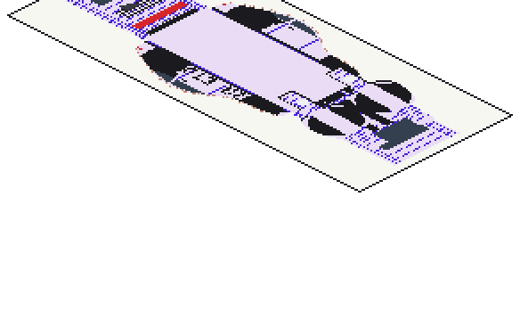

# Ezharuddin Jubaer

**ML researcher** · Researcher, Center for Computational & Data Sciences (CCDS), Independent University, Bangladesh 
 **ECCV 2026 publication** · 3 more papers under review (WACV 2027, ACL Rolling Review, Pattern Recognition) 
 **Seeking a fully funded PhD position, Fall 2027**

---

###  Research areas
- **Multimodal document understanding:** benchmarks for forms, layouts, and multi-page document packets
- **Interpretability and faithfulness:** testing whether a model's attention reflects what it actually uses
- **LLM post-training:** what makes preference data teach a model the right thing
- **Agentic AI for learning:** tutors that adapt to what a learner knows, gets wrong, and cares about

###  Publications
- **BaFCo: A Document Understanding Benchmark for Complex Bangla Form Comprehension** 
  *European Conference on Computer Vision (ECCV) 2026* · [arXiv](https://arxiv.org/abs/2607.05614) 
   Co-developed the annotation pipeline, supervised and reviewed the annotation, and built synthetic form-filling data generation.

- **Khondo: A Multimodal Benchmark for Document Packet Splitting of Bangla Forms** 
  *WACV 2027 (in review)* · [arXiv](https://arxiv.org/abs/2607.21780) 
   Models group pages into documents well but fail to restore page order once pages are shuffled.

- **Between the Line and the Verdict: Attention Evidence in Code LLM Vulnerability Detection** 
  *ACL Rolling Review (under review)* 
   Code-LLM attention does not find the flawed line beyond simple line-length baselines.

- **TRoPE-TUL: Trajectory-User Linking via Spatio-Temporal Rotary Position Embedding** 
  *Pattern Recognition (under review)* 
   Links movement trajectories to users with spatio-temporal rotary position embeddings. Extended from my undergraduate thesis.

###  Research toolkit
`Python` `PyTorch` `vLLM` `QLoRA` `DPO` `multimodal LLMs` `Grad-CAM` `Integrated Gradients` `LaTeX`

###  Contact
ezharuddin00@gmail.com

 

  

